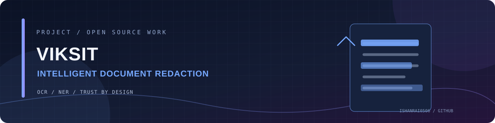

<!-- PROJECT BANNER -->
<div align="center">



# Viksit

### Intelligent document redaction · Trust by Design

Viksit is a document privacy application that combines OCR, named-entity recognition and object detection to identify sensitive information in PDFs and images, then helps users review and redact it before sharing.

<p>
  
  
</p>

</div>

---

## ✨ What it does

<div>

**01 / Hybrid detection**  
Combine OCR, NER and object detection for sensitive content.

</div>
<div>

**02 / Multiple formats**  
Work with PDF, PNG and JPG documents, including scanned pages.

</div>
<div>

**03 / Side-by-side review**  
Compare the original and redacted document.

</div>
<div>

**04 / Audit trail**  
Generate a structured JSON log of redaction actions.

</div>
<div>

**05 / Deployable**  
Run as a Flask application and package with Docker.

</div>

## 🧰 Tech stack

Python · Flask · spaCy · Tesseract OCR · pdf2image · Pillow · Docker · Gunicorn

## 🚀 Getting started

### Prerequisites

Python 3.8+, Tesseract OCR and Poppler must be installed and available on PATH. See the platform-specific installation notes below.

### Installation

```bash
git clone https://github.com/IshanRai0506/Viksit-Intelligent-Document-Redaction.git
cd Viksit-Intelligent-Document-Redaction
python -m venv venv
# Windows
.\venv\Scripts\activate
# macOS / Linux
source venv/bin/activate
pip install -r requirements.txt
python -m spacy download en_core_web_sm
python app.py
```


## 📝 Notes

This project handles potentially sensitive documents. Review every redaction before sharing an output; automated detection can miss content or redact non-sensitive text.


## 🤝 Contributing

Ideas, bug reports and thoughtful improvements are welcome. Open an issue to discuss a change before submitting a pull request.

## 👨‍💻 Maintainer

**Ishan Rai** · [GitHub](https://github.com/IshanRai0506) · [LinkedIn](https://linkedin.com/in/ishanrai-tech)

---

<div align="center">

*Built with curiosity. Improved one commit at a time.* ✨

</div>
